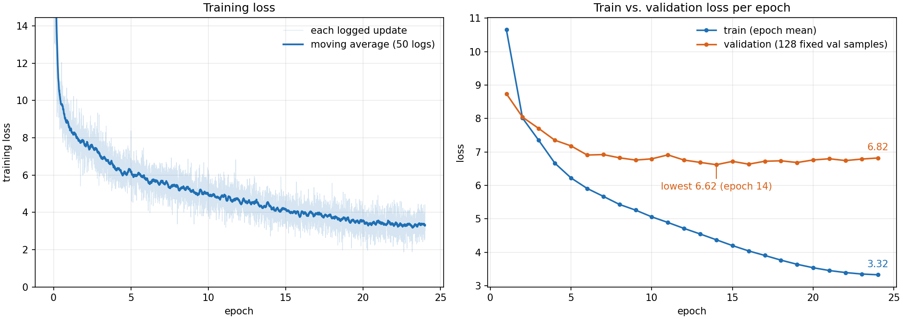
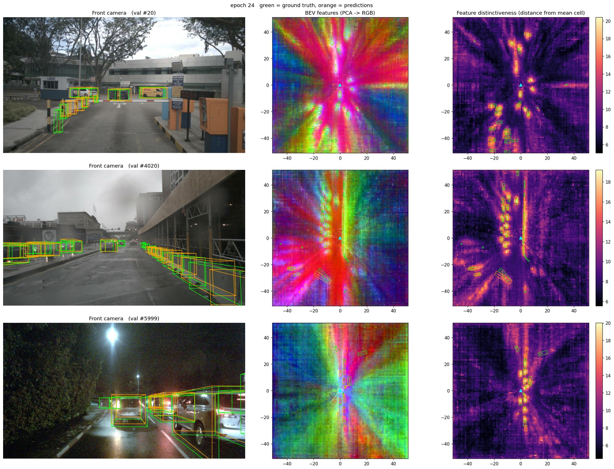
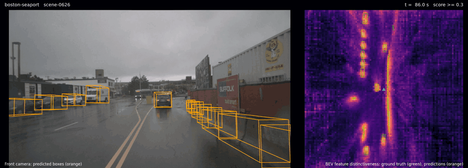
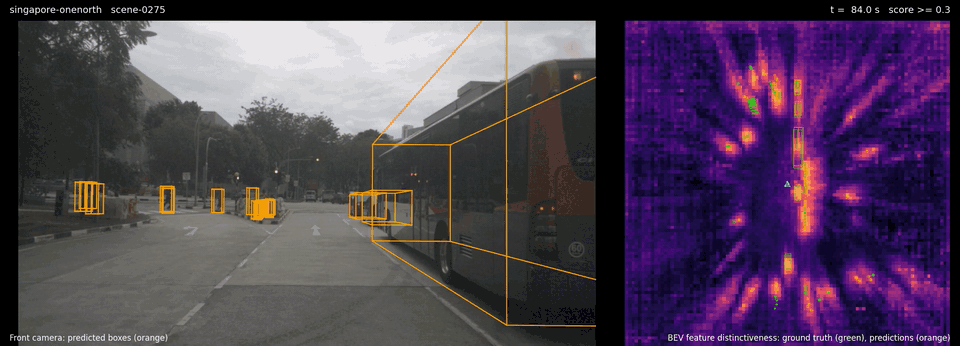
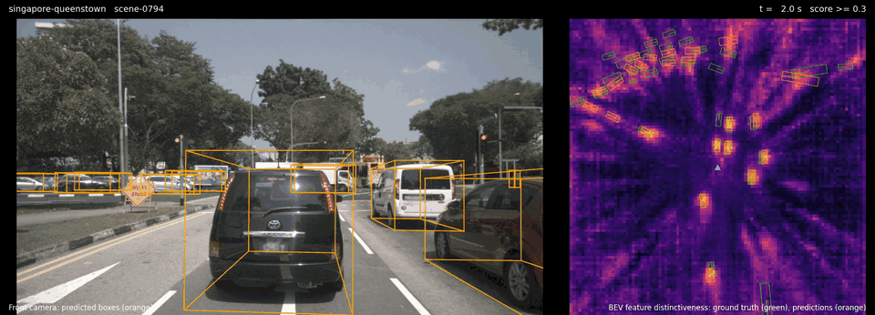
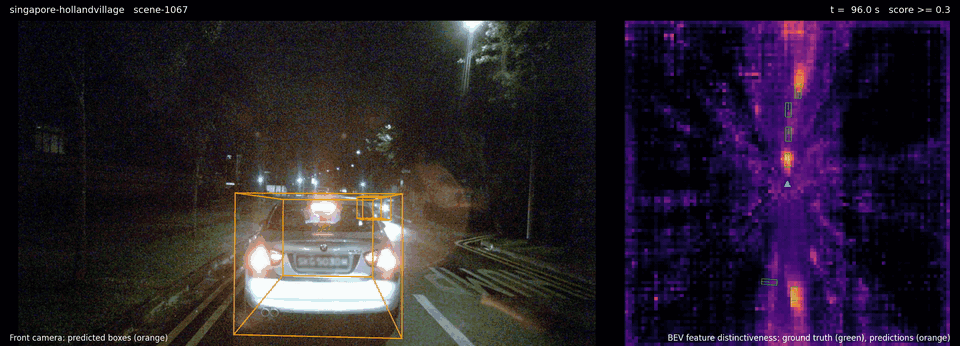

# BEVFormer in Pure PyTorch

[](https://github.com/bskkimm/BevFormer_from_scratch/actions/workflows/tests.yml)

A from-scratch reimplementation of **BEVFormer** ([Li et al., ECCV 2022](https://arxiv.org/abs/2203.17270)):
multi-camera 3D object detection in bird's-eye view with spatiotemporal transformers. It uses no
MMDetection, MMDetection3D or MMCV. The image backbone with deformable convolutions, the FPN,
deformable attention, the BEV encoder (spatial cross-attention and temporal self-attention), the detection
head, Hungarian matching and losses, the nuScenes data pipeline, and the training, validation and
visualization tooling are all written here on top of PyTorch and TorchVision (SciPy supplies the
Hungarian assignment).

## Results

A full 24-epoch run on the official nuScenes train split (700 scenes, 28,130 samples) with a 100 x 100
BEV grid:

| | |
|---|---|
| Train loss (epoch mean) | 10.66 to **3.32** |
| Validation loss (128 fixed val samples) | 8.74 to 6.82 (lowest 6.62 at epoch 14) |
| Training time | 166 h on one RTX PRO 6000 (96 GB), 6.9 h per epoch |
| Official nuScenes mAP / NDS | **not evaluated yet** |



These are loss values, not detection metrics. `eval.py` reports only sanity metrics, and the official
nuScenes devkit evaluation is not part of this repository yet, so no accuracy comparison with the
official BEVFormer is claimed. The run is a single seed, with a 100 x 100 BEV grid (official Base:
200 x 200) and an ImageNet-initialised backbone. The full report, including the interruptions and the
bugs fixed on the way, is in [docs/analysis/bevformer-24-epoch-run.md](docs/analysis/bevformer-24-epoch-run.md).

After epoch 24, on three fixed validation samples (a parking lot, a rainy street, night traffic):



Left: front camera with the 3D boxes projected onto it. Middle: PCA of the learned BEV features. Right:
how far each BEV cell's feature is from the average cell. Green is ground truth, orange is the model's
prediction (score >= 0.3).

## Demo

Ten-second excerpts of the epoch-24 model on validation scenes it was never trained on. In each frame the
front camera (left) shows the **predicted** boxes projected onto the image, and the BEV feature map
(right) shows ground truth (green) and predictions (orange). Playback is real time at 2 frames/s, the
nuScenes keyframe rate.

**Boston Seaport** (rain)



**Singapore One-North**



**Singapore Queenstown**



**Singapore Holland Village** (night)



Full two-minute videos (several validation scenes per map), from the
[v0.1.0 release](https://github.com/bskkimm/BevFormer_from_scratch/releases/tag/v0.1.0):
[Boston Seaport](https://github.com/bskkimm/BevFormer_from_scratch/releases/download/v0.1.0/boston-seaport.mp4) (39 MB),
[One-North](https://github.com/bskkimm/BevFormer_from_scratch/releases/download/v0.1.0/singapore-onenorth.mp4) (43 MB),
[Queenstown](https://github.com/bskkimm/BevFormer_from_scratch/releases/download/v0.1.0/singapore-queenstown.mp4) (47 MB),
[Holland Village](https://github.com/bskkimm/BevFormer_from_scratch/releases/download/v0.1.0/singapore-hollandvillage.mp4) (74 MB).
They are rendered by `bevformer/scripts/make_demo_videos.py`. The camera frames come from the
[nuScenes](https://www.nuscenes.org) dataset and are shown under its non-commercial
[terms of use](https://www.nuscenes.org/terms-of-use).

## What is implemented

| Part | Where | What it does |
|---|---|---|
| Data | `bevformer/data/` | nuScenes dataset returning a temporal queue per sample (4 frames x 6 cameras, ego-motion deltas, current-frame 3D boxes with velocities), the official train/val scene split, the official ground-truth filters (valid flag, BEV range), image resize and normalization |
| Backbone, neck | `bevformer/models/backbone/`, `neck/`, `grid_mask.py` | ResNet-101 with modulated deformable convolution (DCNv2) in the last two stages, a 4-level FPN, GridMask augmentation |
| BEV encoder | `bevformer/models/transformer/` | learned BEV queries; spatial cross-attention (pillar points projected into every camera); temporal self-attention over the previous BEV warped by ego motion; multi-scale deformable attention built on `grid_sample` |
| Decoder, head | `bevformer/models/transformer/decoder.py`, `models/heads/` | 900 object queries, deformable decoder with the official box refinement, class and 10-dimensional box branches |
| Losses | `bevformer/models/losses/` | Hungarian matcher, focal classification loss and L1 box loss, with auxiliary losses on every decoder layer |
| Training engine | `bevformer/engine/` | gradient accumulation, AdamW with a backbone learning-rate multiplier and the official cosine/warmup schedule, bf16/TF32 mixed precision with fp32 islands, checkpoints and resume, MLflow logging, BEV visualization, validation-subset evaluation |
| Tools | `bevformer/scripts/` | throughput benchmark, one-batch overfit check, validation watcher, training-curve plot, demo videos |

## Training recipe

The defaults follow the official BEVFormer-Base recipe, except for the points in bold:

| | Official BEVFormer-Base | This repository |
|---|---|---|
| Backbone | ResNet-101 (caffe), DCNv2, FCOS3D-pretrained | torchvision ResNet-101 with **ImageNet weights**, DCNv2 |
| BEV grid | 200 x 200 | **100 x 100** (2.2x faster here) |
| Layers | 6 encoder / 6 decoder, 900 queries | same |
| Optimizer | AdamW 2e-4, backbone x0.1, weight decay 0.01, clip 35 | same |
| Schedule | 24 epochs, cosine per epoch, 500-iteration warmup | same |
| Batch | 8 GPUs x 1 sample | **1 GPU, 8 accumulation steps** (effective batch 8) |
| Precision | fp32 | **bf16 autocast + TF32**, with fp32 for the head, camera projection and BEV warp |
| Augmentation | GridMask, photometric distortion | GridMask only |

## Repository layout

```text
bevformer/
├── data/             nuScenes temporal-queue dataset, official splits, transforms, collate
├── models/
│   ├── backbone/     ResNet-101 + DCNv2
│   ├── neck/         FPN
│   ├── transformer/  deformable attention, spatial/temporal attention, BEV encoder, decoder
│   ├── heads/        detection head
│   ├── losses/       Hungarian matcher, focal and L1 losses
│   ├── grid_mask.py  GridMask augmentation
│   └── bevformer.py  the assembled model
├── engine/           trainer, optimizer and schedule, build helpers, evaluator, checkpoints,
│                     progress, validation, BEV visualization
└── scripts/          throughput benchmark, overfit-one-batch, validation watcher,
                      training-curve plot, demo videos
train.py, eval.py     training / evaluation entry points
COMMAND_GUIDE.md      canonical commands
notebooks/            literate architecture walkthrough
docs/analysis/        report on the 24-epoch run
docs/assets/          figures and GIF previews used in this README
tests/                unit tests on small synthetic fixtures
```

## Setup

Create a Python 3.10+ environment and install the dependencies:

```bash
pip install -r requirements.txt
pip install -e .
```

A CUDA GPU is needed to train at full size (the tests run on CPU). `ffmpeg` is needed only for the demo
videos. Prepare nuScenes `v1.0-trainval` in its standard layout (metadata tables and `samples/CAM_*`
images) at `~/dataset/nuscenes`, or pass `--dataroot`. Dataset files are not distributed with this
repository.

## Usage

[`COMMAND_GUIDE.md`](COMMAND_GUIDE.md) is the full command reference; the essentials:

```bash
# smoke test of the whole pipeline (about 3 minutes)
python train.py --subset 64 --epochs 2 --vis-every-epochs 1 --output-dir runs/smoke

# full training, logged to MLflow (local SQLite store: mlflow.db)
python train.py --mlflow --output-dir runs/bevformer-r101dcn-bev100

# resume an interrupted run from its last completed epoch, in the same MLflow run
python train.py --mlflow --output-dir runs/bevformer-r101dcn-bev100 \
  --resume runs/bevformer-r101dcn-bev100/checkpoints/latest.pth

# MLflow UI: loss curves, live progress and ETA, BEV images every 2 epochs
mlflow ui --backend-store-uri sqlite:///mlflow.db --host 127.0.0.1 --port 5000
```

A training run writes `checkpoints/latest.pth` and `epoch_XX.pth`, BEV figures, `final.pth` and
`config.json` into its output directory. Next to it:

```bash
# validation loss on a fixed 128-sample subset, logged to the running job (see COMMAND_GUIDE.md)
python -u bevformer/scripts/watch_validation.py --run-dir runs/<name> --run-id <mlflow run id>

# training-curve figure from MLflow, and the per-map demo videos
python bevformer/scripts/plot_training_curves.py --run-id <mlflow run id> --out training_curves.png
python bevformer/scripts/make_demo_videos.py --run-dir runs/<name>

# throughput of the exact training setup (data loading vs GPU step)
python bevformer/scripts/benchmark_throughput.py --mode e2e
```

### Evaluation

```bash
python eval.py --dataroot ~/dataset/nuscenes --checkpoint runs/<name>/final.pth
```

`eval.py` reports lightweight sanity metrics (greedy center-distance match rate, mean center error),
**not** the official nuScenes mAP/NDS. The official protocol needs `nuscenes-devkit`, a submission JSON
and the full validation split; it can be layered on top of
`bevformer.engine.evaluator.decode_predictions` without changing anything else.

### Sanity check

`bevformer/scripts/overfit_one_batch.py` trains a tiny model on one fixed synthetic batch. A healthy
implementation drives the loss down substantially within a couple of hundred steps, with no dataset or GPU:

```bash
python bevformer/scripts/overfit_one_batch.py --steps 200
```

## Literate walkthrough

`notebooks/bevformer_e2e_walkthrough.ipynb` rebuilds the entire architecture from scratch, cell by cell,
**without importing the `bevformer` package**. Each module is copied in verbatim from its source file and
paired with a markdown explanation (mathematical definition and tensor-shape contract) and a runnable
probe cell that exercises it on tiny synthetic inputs. It is a second, teaching-oriented construction of
the same model, useful for building intuition or checking that "the math" and "the code" agree. A test
(`tests/test_notebook_sync.py`) fails if a copied definition drifts from the package.

## Tests

```bash
pytest tests/ -v
```

The tests run on small synthetic fixtures, without network access or the nuScenes download. A few
precision checks need a CUDA GPU and are skipped without one.

## Limitations

- No official nuScenes mAP/NDS yet; the validation numbers above are a loss on 128 samples.
- 100 x 100 BEV grid (official: 200 x 200) and an ImageNet-initialised backbone (official: FCOS3D).
- No photometric distortion during training.
- bf16 autocast and TF32 instead of fp32, with fp32 islands verified against fp32 on real samples.
- A single run with a single seed.

## References

- Z. Li et al., [BEVFormer: Learning Bird's-Eye-View Representation from Multi-Camera Images via
  Spatiotemporal Transformers](https://arxiv.org/abs/2203.17270), ECCV 2022;
  [official implementation](https://github.com/fundamentalvision/BEVFormer).
- X. Zhu et al., [Deformable DETR](https://arxiv.org/abs/2010.04159), ICLR 2021.
- H. Caesar et al., [nuScenes: A multimodal dataset for autonomous driving](https://arxiv.org/abs/1903.11027), CVPR 2020.
- The sibling project [DETR3D-from-Scratch](https://github.com/bskkimm/DETR3D-from-Scratch), whose
  repository structure this one follows.

## License

MIT, see [LICENSE](LICENSE).
