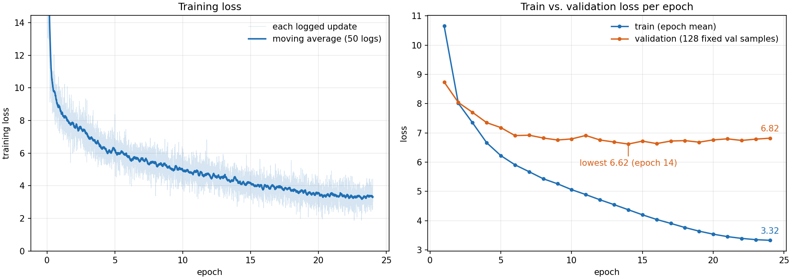

# BEVFormer 24-epoch training run

Report on the run behind the results in the README: what was trained, how it went,
which bugs had to be fixed on the way, and what the numbers do and do not show.

## Summary

| | |
|---|---|
| Model | ResNet-101 + DCNv2, FPN, 100x100 BEV, 6 encoder / 6 decoder layers, 900 queries (61.0 M parameters) |
| Data | official nuScenes train split: 700 scenes, 28,130 samples, 24 epochs |
| Hardware | one NVIDIA RTX PRO 6000 Blackwell Max-Q (96 GB), 32 CPUs, local NVMe |
| Training time | 166 h (6.9 days) of pure training, 6.9 h per epoch, 0.89 s per sample |
| Wall clock | 27 Sep 22:53 to 6 Oct 18:26 (JST): 8.8 days including four unplanned interruptions and one planned pause |
| Train loss | 10.66 (epoch 1) to 3.32 (epoch 24) |
| Validation loss | 8.74 (epoch 1) to 6.82 (epoch 24); lowest 6.62 at epoch 14 |
| Official nuScenes mAP / NDS | **not evaluated** |

Validation loss is measured on 128 fixed validation samples (a seeded, scene-spread subset
of the 6,019), once per epoch, by `bevformer/scripts/watch_validation.py`. It is a loss, not
a detection metric.

## Configuration

The run used the default `train.py` settings, launched as
`python train.py --mlflow --output-dir runs/<name>` (every argument is stored in the run's
`config.json`). Compared with the official BEVFormer-Base recipe:

| | Official BEVFormer-Base | This run |
|---|---|---|
| Backbone | ResNet-101 (caffe), DCNv2 in layer3-4, FCOS3D-pretrained | torchvision ResNet-101 with ImageNet weights, DCNv2 in layer3-4; stem and first stage frozen, BatchNorm statistics frozen |
| BEV grid | 200 x 200 | **100 x 100** (same 102.4 m range, 1.02 m cells) |
| Encoder / decoder | 6 / 6 layers, 8 spatial-attention points, 900 queries | same |
| Optimizer | AdamW lr 2e-4, backbone x0.1, weight decay 0.01, clip 35 | same |
| Schedule | 24 epochs, cosine per epoch to 1e-3 x lr, 500-iteration linear warmup from 1/3 | same |
| Batch | 8 GPUs x 1 sample | 1 GPU, 8 gradient-accumulation steps (effective batch 8) |
| Precision | fp32 | bf16 autocast + TF32 matmuls, with the detection head, camera projection and BEV warp kept in fp32 |
| Ground truth | `use_valid_flag` + `ObjectRangeFilter` | same |
| Augmentation | GridMask and photometric distortion | GridMask only; the photometric-distortion utility in `bevformer/data/transforms.py` is not enabled |
| Image normalization | caffe style: BGR, mean 103.53 / 116.28 / 123.675, std 1 | RGB with ImageNet mean/std, matching the torchvision weights |
| Image input | 1600 x 900, 6 cameras, queue of 4 frames | same |

## Per-epoch losses

| Epoch | Train (epoch mean) | Validation (128 samples) |
|---:|---:|---:|
| 1 | 10.66 | 8.74 |
| 2 | 8.01 | 8.04 |
| 3 | 7.35 | 7.70 |
| 4 | 6.66 | 7.35 |
| 5 | 6.22 | 7.18 |
| 6 | 5.91 | 6.91 |
| 7 | 5.67 | 6.92 |
| 8 | 5.43 | 6.82 |
| 9 | 5.26 | 6.76 |
| 10 | 5.06 | 6.79 |
| 11 | 4.89 | 6.91 |
| 12 | 4.71 | 6.76 |
| 13 | 4.54 | 6.69 |
| 14 | 4.37 | 6.62 (lowest) |
| 15 | 4.20 | 6.72 |
| 16 | 4.04 | 6.63 |
| 17 | 3.90 | 6.72 |
| 18 | 3.76 | 6.74 |
| 19 | 3.64 | 6.68 |
| 20 | 3.53 | 6.76 |
| 21 | 3.45 | 6.80 |
| 22 | 3.39 | 6.74 |
| 23 | 3.35 | 6.79 |
| 24 | 3.32 | 6.82 |

## How the run went

| When (JST) | What happened | Work lost |
|---|---|---|
| 27 Sep 22:53 | run started | |
| 29 Sep, afternoon | a DataLoader worker was killed for memory near the end of epoch 6; resumed 16:59 from the epoch-5 checkpoint after the dataset memory fix | about 7 h |
| 30 Sep 06:47 | the machine lost power or was reset during epoch 7; resumed 09:52 from the epoch-6 checkpoint | about 6.8 h |
| 1 Oct 02:18 | killed by the kernel out-of-memory killer while other jobs on the machine used the RAM; resumed 07:43 | about 2.3 h |
| 1 Oct 16:14 | killed by the memory watchdog (`systemd-oomd`), same cause; resumed automatically at 18:04 once memory was free | about 1 h |
| 2 Oct 01:25 | paused on purpose right after epoch 10 was saved; resumed 18:16 | none |
| 6 Oct 18:26 | epoch 24 finished, `final.pth` saved | |

Every resume continued from the last completed epoch with weights, optimizer state and
learning-rate position restored, in the same MLflow run. The interrupted epoch is trained
again, so MLflow holds two versions of those steps; the plot script keeps the newest.

## Bugs found on the way to a healthy run

An earlier attempt plateaued at a loss near 20 where the official Tiny log reaches about 12
after 800 updates. Short Tiny-like experiments (800 updates each, compared with the official
log) isolated the causes below. After all fixes the same experiment reached about 11.8
against the official 12.2, and the full run then trained smoothly.

**Training signal**

- **Decoder reference points.** Each decoder layer re-predicted its reference point from its
  hidden state instead of refining the previous layer's box, so matching stayed unstable and
  the last layer was worse than the first. The decoder now follows the official box
  refinement: layer 0 attends at `sigmoid(Linear(query_pos))`, each later layer at the previous
  layer's detached box center.
- **Temporal warp frame.** `can_bus[16:18]` held the ego translation in global coordinates but
  the warp applies it in the LIDAR_TOP (BEV) frame, so the previous BEV was shifted the wrong
  way whenever the car did not head along global x (off by 2.4 m on average, up to 9 m). It now
  stores the current LIDAR_TOP origin in the previous frame's coordinates, and a test warps
  per-cell coordinates to check exact world alignment.
- **Ground truth.** Velocity targets were all zero, and 26.7% of training targets (200-sample check) were
  objects no sensor sees or boxes the bounded reference points cannot reach. Velocities now follow the
  nuScenes devkit's `box_velocity` and both official filters are applied.
- **Architecture details** that match the official model but did not change the short-run loss:
  deformable-attention offsets initialised on the official grid, and 2 learned sampling points
  around each of the 4 pillar anchors (8 in total).

**Mixed precision.** Autocast alone silently broke three things, so these parts stay in fp32:

- `inverse_sigmoid`: in bf16, `1 - 1e-5` rounds to exactly 1.0, `x / (1 - x)` became infinite
  and the backward pass produced NaN gradients; bf16 training diverged by step 2.
- The detection head: bf16's 7-bit mantissa moved decoded box centers by 6 cm on average
  (17 cm at most) against fp32, exactly what the L1 loss and mATE measure.
- Camera projection and BEV warp: written as matmuls (`einsum`, `affine_grid`), which autocast ran
  in bf16 and TF32 in reduced precision, shifting projected pixels by several pixels. They are
  now elementwise fp32 arithmetic. `--no-tf32` also used to turn off cuDNN's TF32, making
  it slower than stock PyTorch; it now controls matmuls only.

**Memory.** The dataset kept the raw nuScenes tables (8.8 GB: 2.6 M sample_data rows, 2.6 M
ego poses, 1.2 M annotations). Forked DataLoader workers share them copy-on-write, but Python
reference counting and garbage collection write to every object they touch, so each
persistent worker slowly made a private copy; after 6 epochs one worker reached 12.2 GB and was
killed. Everything a sample needs is now precomputed into numpy arrays and the tables are
dropped (worker private memory 0.53 GB). Verified against the old path on 31 real samples:
images, boxes, labels and queues identical; projections within 0.13 px.

## Reading the validation curve

Validation loss fell until about epoch 6, stayed at roughly 6.6 to 6.9 after that, and ended at
6.82, slightly above its lowest value (6.62 at epoch 14), while the training
loss kept falling. That gap, together with the learning rate decaying to nearly zero in the
last epochs, is what overfitting looks like, but the evidence is thin:

- the 128-sample subset is noisy (neighbouring epochs differ by about 0.1, the drift from
  epoch 14 to 24 is 0.2);
- a loss is not a detection metric: it can rise while mAP/NDS holds, because wrong confident
  predictions are penalised heavily.

The way to settle it is the official nuScenes evaluation of the epoch-14 and epoch-24
checkpoints (or a validation loss over far more samples).

## Limits and next steps

- No official mAP/NDS yet. `eval.py` reports only sanity metrics (greedy center-distance match
  rate and mean center error); the devkit evaluation is a separate step.
- One run, one seed; no claim of statistical equivalence with the official model.
- No photometric distortion during training, which the official pipeline applies.
- 100 x 100 BEV and an ImageNet-initialised backbone, not the official 200 x 200 and FCOS3D
  initialisation. A 200 x 200 grid costs about 2.2x the training time here.
- bf16 autocast instead of fp32; the fp32 islands above were verified against fp32 on real samples.
